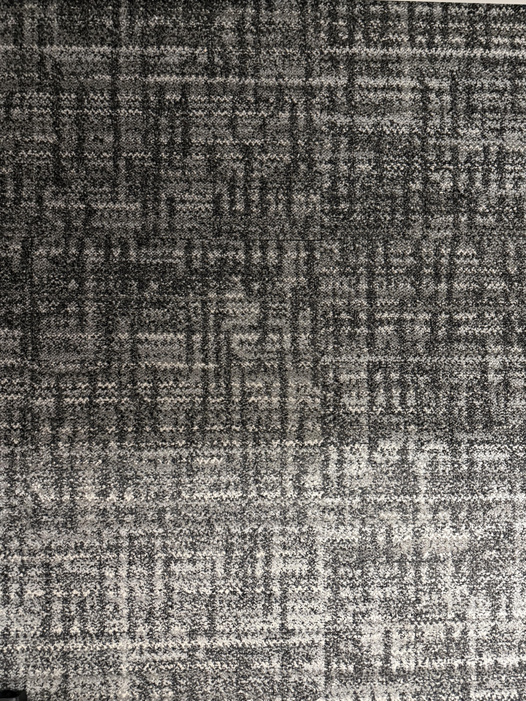

+++
title = '🔎 #314 - Trombone 📎'
date = 2026-11-04
draft = false
expiryDate = 2027-02-02
tags = [
'HARD',
]
+++
<!--more-->

### Translation...
The French word for _paperclip_ is _trombone_. Can you find the paperclip?
### 🎯 Location
{}
🗓️ The location for this object will be posted tomorrow -- See you then!
{}