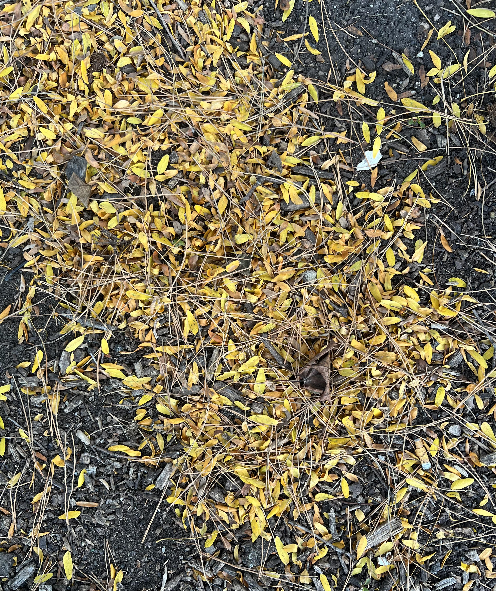

+++
title = '🔎 #326 - A kernel of truth 🌽'
date = 2026-11-16
draft = false
expiryDate = 2027-02-14
tags = [
'IMPOSSIBLE',
]
+++
<!--more-->

Find the single kernel of corn! Sorry!
### ❓Hints
{}
- eh, it looks like corn, but it doesn't really jump out at you
{}
### 🎯 Location
{}
🗓️ The location for this object will be posted tomorrow -- See you then!
{}